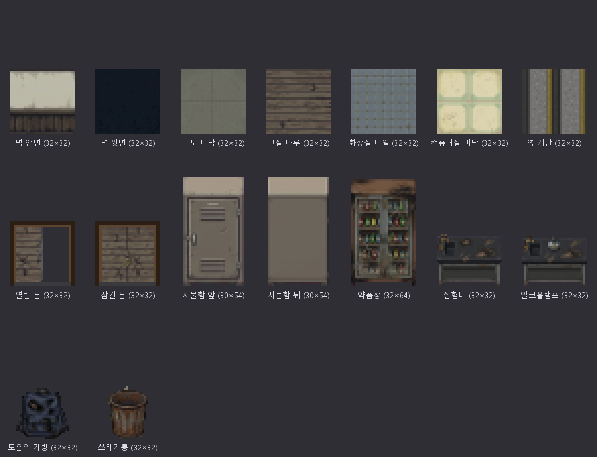

# 에셋 목록 (층별)

기준일: 2026-10-17

게임에 필요한 그래픽은 모두 72개이고, 그중 20개가 완성되어 52개가 남았습니다(선택인 계단 양끝 1줄 제외). 이 밖에 컷신 CG 9장(완성)과 추가 예정 9개가 있고, 소리는 일부를 CC0 소리 파일로 바꿨습니다(「소리」 참고). 상태 칸은 에셋을 올리는 PR에서 이 파일도 함께 고쳐 바꿉니다. 영문 이름은 파일 이름(`assets/sprites/<이름>.png`)이자 `tools/sprites.py` 설정 이름입니다.

## 제작 기준 (모든 에셋 공통)

새 에셋은 아래 완성 에셋들과 나란히 놓았을 때 한 게임처럼 보여야 합니다. 숫자 기준은 이 완성 에셋에서 직접 잰 값입니다.



### 시점과 크기

| 항목 | 기준 |
| --- | --- |
| 시점 | 쯔꾸르(RPG Maker VX Ace/MV) 시점. 바닥은 바로 위에서, 벽·가구는 정면에서 보고 윗면만 얇게 보인다. 비스듬한 각도(아이소메트릭)·원근 금지, 세로선은 세로로 가로선은 가로로 |
| 한 칸 | 32×32px. 키 큰 가구는 32×64(아래 칸이 바닥, 위 칸은 벽 앞으로 솟음). 사물함은 30×54 |
| 도트 크기 | 게임 1px = 도트 1개. AI에는 “도트 한 개를 8×8 블록으로”(한 칸 = 256×256) 요청한다 |
| 선 굵기 | 최소 2도트. 1도트짜리 가는 다리·선은 32px로 줄이면 사라진다 |
| 빛 방향 | 왼쪽 위에서 비춘다 → 오른쪽·아래가 어둡다 |
| 배경 | 마젠타(#FF00FF) 단색 (가공 도구가 지운다). 물건 뒤에 바닥·벽을 그리지 않는다 |
| 캐릭터 | 32×32 칸 안에 키 28\~30px, 2\~2.5등신 쯔꾸르 비율. 4방향 모두 같은 비율·같은 옷 |

### 보는 방향 (놓이는 자리에 따라)

| 놓이는 자리 | 그리는 면 | 예 |
| --- | --- | --- |
| 위쪽 벽 앞 | 앞면 (문·손잡이·서랍) | 칠판, 약품장, 사물함 앞 |
| 아래쪽 벽 앞 | 뒷면 + 넓게 보이는 윗면 | 사물함 뒤 |
| 방 가운데 | 앞면 + 윗면이 잘 보이게 (위에서 살짝) | 책상, 실험대 |
| 바닥 소품 | 바로 위에서, 칸 가운데, 작은 그림자만 | 가방, 공, 명찰 |
| 벽에 거는 물건 | 32×64 중 위 칸에만 그리고 아래 칸은 비운다 (벽 앞 바닥 자리) | 게시판, 열쇠함 |

### 색과 밝기

밤의 폐교를 손전등 하나로 비추는 게임이라, 색은 탁하고 어둡게 맞춥니다. 게임 안에서 손전등이 더 어둡게 덮으므로 그림 자체를 어둡게 칠할 필요는 없습니다.

| 항목 | 기준 (완성 에셋 측정값) |
| --- | --- |
| 가구·소품 평균 밝기 | 15\~40% (가방 15%, 실험대 21%, 약품장 26%, 사물함 40%) |
| 벽·바닥 평균 밝기 | 30\~50% (교실 마루 31%, 복도 바닥 41%, 벽 앞면 49%) |
| 가장 밝은 점 | 85% 이하 — 순백색 금지 (완성 에셋의 가장 밝은 1%가 83%) |
| 채도 | 평균 10\~30% — 바랜 색. 원색·형광색 금지, 빨강은 아주 드물게 (녹·그을음·경고 정도) |
| 외곽선 | 1도트. 순검정(#000000) 대신 아주 어두운 갈색·회색 (#251f1c, #2e2e30) |
| 질감 | 평평한 색 면 + 얼룩·먼지 점 몇 개. 그라데이션·안티에일리어싱·사진 질감 금지 |

팔레트: 완성 에셋에서 가장 많이 쓴 16색을 계열별로 묶었습니다. 이 색만 써야 하는 것은 아니지만, 새 색도 이 범위의 밝기·채도 안에서 고릅니다.

| 계열 | 색 |
| --- | --- |
| 그림자·외곽선 | `#111720` (벽 윗면 남색), `#251f1c`, `#2e2e30`, `#3a3430` |
| 나무·녹 (탁한 갈색) | `#423d3b`, `#5b4c41`, `#62594e`, `#6b6359` |
| 금속·콘크리트 (청회색) | `#4a4946`, `#636764`, `#686964`, `#6e6c63`, `#7a7c78` |
| 바랜 크림 (벽·타일의 밝은 면) | `#aba58e`, `#c1c0a1`, `#dbd3ae` |

### 분위기와 금지 사항

- 1980\~90년대 한국 시골 학교가 10년간 버려진 모습: 먼지, 바랜 페인트, 녹, 벗겨진 칠
- 잔혹 묘사 없음 (피·시체 금지). 공포는 어둠과 흔적으로
- 글자·숫자·치수선·테두리·격자선·워터마크 금지 (옥상 「7.13」 새김 글씨만 예외)
- 바닥 타일은 네 방향으로 이어 붙여도 이음매가 보이지 않게 (가장자리에 띠·선 금지)

## 만드는 순서와 검수

프롬프트 원문과 가공 도구 사용법은 [에셋 제작 가이드](%EC%97%90%EC%85%8B_%EC%A0%9C%EC%9E%91_%EA%B0%80%EC%9D%B4%EB%93%9C.md)에 있습니다. 같은 대화창에서 이어 만들어야 그림체가 흔들리지 않습니다.

1. AI(Gemini·ChatGPT) 새 대화를 열고, 위 참고 그림(또는 `docs/asset_reference.png`)을 첨부해 가이드 3-1의 “그림체 고정” 첫 메시지를 보낸다
2. 같은 대화에서 “Same style as before.”로 시작하는 요청으로 4\~6개씩 묶어 받는다 (가이드 4장에 에셋별 프롬프트)
3. 결과 원본을 `assets/source/<영어이름>.png`로 저장한다 (Git에 올리지 않음)
4. `tools/sprites.json`에 한 줄 추가 후 `python tools/sprites.py` → `assets/sprites/<파일 이름>.png`와 `manifest.json`이 생긴다
5. `python tools/serve.py` → `localhost:8123/?dev`에서 그 에셋이 나오는 장소를 열어 아래 검수를 한다
6. PNG와 `manifest.json`을 **함께** 커밋해 PR로 올린다 (manifest가 빠지면 게임이 그림을 불러오지 않는다)
7. 같은 PR에서 이 문서의 상태를 “완성”으로 바꾼다. 만들기 시작할 때 이슈에 맡은 에셋을 적어 같은 것을 두 사람이 만들지 않게 한다

검수 기준 — 게임 화면에서 확인한다:

- 옆에 있는 완성 에셋과 나란히 봤을 때 밝기·채도가 튀지 않는다
- 정면/위 시점이 맞고, 비스듬하거나 원근이 없다
- 외곽선이 1도트이고 순검정이 아니다
- 32px 크기에서 무엇인지 한눈에 알아볼 수 있다
- 가장자리에 마젠타 번짐·흰 테두리가 없다
- 바닥 타일은 여러 칸을 이어 붙였을 때 줄무늬·이음매가 없다
- 손전등 빛 안(밝은 데)과 가장자리(어두운 데) 모두에서 알아볼 수 있다

## 공통 (여러 층에서 같이 씀)

한 번 만들면 모든 층에 적용됩니다. 20개 중 11개 완성, 9개 남음.

| 에셋 | 파일 이름 | 크기·방향 | 그릴 내용 | 쓰는 곳 | 상태 |
| --- | --- | --- | --- | --- | --- |
| 벽 앞면 | `wall_face` | 32×32 타일 · 정면 | 완성. 위는 바랜 크림색 회벽, 아래 1/3은 어두운 나무 판자 | 모든 맵 (아래가 바닥인 벽) | 완성 |
| 벽 윗면 | `wall_top` | 32×32 타일 · 위에서 | 완성. 어두운 남색 단색 (위에서 본 두꺼운 벽) | 모든 맵 | 완성 |
| 복도 바닥 | `floor_corridor` | 32×32 타일 · 위에서 | 완성. 회녹색 인조석, 큰 사각 줄눈 | 1·2층 복도, 현관, 계단실, 옥상 계단탑 | 완성 |
| 교실 마루 | `floor_wood` | 32×32 타일 · 위에서 | 완성. 낡은 갈색 나무 널빤지 가로줄 | 교실, 교무실, 경비실, 과학실·준비실, 음악실, 방송실 | 완성 |
| 화장실 타일 | `floor_tile` | 32×32 타일 · 위에서 | 완성. 청회색 작은 사각 타일 | 1·2층 화장실 | 완성 |
| 옆 계단 | `floor_stairs_side` | 32×32 · 위에서 | 완성. 세로로 놓인 회색 계단 + 노란 미끄럼 방지선 | 1·2층 계단실, 옥상 계단탑 | 완성 |
| 계단 | `floor_stairs` | 32×32 · 위에서 | 완성 | 지금 맵에서는 쓰지 않음 | 완성 |
| 계단 왼쪽·오른쪽 끝 (선택) | `floor_stairs_l`, `floor_stairs_r` | 32×32 · 위에서 | 2칸 폭 계단의 왼쪽 끝·오른쪽 끝. 벽과 맞닿는 쪽에만 테두리. 없으면 계단 그림으로 대신한다 | 2칸 폭 계단 | 완료 (32×32 가공, 지금은 맵에서 쓰지 않음) |
| 계단 난간 | `rail_h` | 32×32 · 정면 | 녹슨 쇠 손잡이 가로대 + 기둥. 여러 칸을 이으면 한 줄로 이어지도록 가로대가 칸 양끝에 닿게 | 1·2층 계단실 | 제작 필요 |
| 열린 문 | `door_open` | 32×32 · 정면 | 완성. 나무 미닫이문이 반쯤 열려 너머 바닥이 보임 | 1·2층 교실·특별실 문 | 완성 |
| 잠긴 문 | `door_locked` | 32×32 · 정면 | 완성. 같은 문이 닫히고 가운데 자물쇠 | 1·2층 잠긴 방, 옥상 계단탑 철문 | 완성 |
| 창문 | `window` | 32×32 · 정면, 칸을 꽉 채움 | 벽에 난 창. 어두운 밤하늘이 비치는 유리, 녹슨 창틀. 학교와 침실에 같이 쓰므로 단순하게 | 2층 창, 침실 창 | 제작 필요 |
| 사물함 (앞면) | `locker` | 30×54 · 정면 | 완성. 회갈색 철제, 통풍구 2줄, 손잡이 | 1층 교실·복도, 2층 음악실·복도 | 완성 |
| 사물함 (뒷면) | `locker_back` | 30×54 · 뒷면 + 윗면 | 완성. 같은 사물함의 뒷판 | 교무실 (아래쪽 벽) | 완성 |
| 칠판 | `board` | 32×64 · 위쪽 벽에 걸림 | 긴 칠판의 한 토막(3토막을 나란히 붙여 한 칠판). 위 칸: 짙은 초록 판에 지워진 분필 자국, 나무 틀은 위아래에만(좌우 틀 없음). 아래 칸: 맨 위에 얇은 분필 받침과 분필 하나, 나머지는 비움 | 1층 1·2·3반, 2층 음악실 | 제작 필요 |
| 책상 | `desk` | 32×32 · 앞면 + 윗면 | 낡은 나무 학생 책상. 윗판(밝은 갈색 넓은 사각형)이 위쪽 절반, 아래는 어두운 앞판, 맨 아래 의자 등받이 끝이 작은 덩어리로. 가는 다리 금지 | 1층 교실·교무실, 침실 | 제작 필요 |
| 거울 | `mirror` | 32×64 · 정면 | 위 칸: 얼룩진 작은 벽거울. 아래 칸: 흰 도자기 세면대 | 1·2층 화장실 | 제작 필요 |
| 화장실 칸 | `stall` | 32×32 · 정면 | 바랜 연두색 칸막이 앞면, 긁힌 자국, 문이 살짝 열림. 위아래로 두 칸 쌓으면 이어지게 | 1·2층 화장실 | 제작 필요 |
| 책장 | `shelf` | 32×64 · 정면 | 키 큰 나무 책장, 바랜 책·바인더. 학교와 침실에 같이 씁 | 2층 방송실, 침실 | 제작 필요 |
| 그을음 (바닥) | `scorch` | 32×32 · 위에서 (바닥 장식) | 불규칙한 검은 그을음 자국만. 바닥은 그리지 않는다 | 학교 변화 2단계 — 1층 복도·과학실·준비실, 2층 복도·계단실 | 제작 필요 |

## 캐릭터

모든 층에 나오며 7개 모두 남았습니다.

| 에셋 | 파일 이름 | 크기·방향 | 그릴 내용 | 쓰는 곳 | 상태 |
| --- | --- | --- | --- | --- | --- |
| 주인공 재민 — 아래를 봄 | `player_down` | 32×32 · 정면 | 20대 중반 한국 남자. 짧은 검은 머리, 짙은 남색 재킷, 어두운 바지. 키 28\~30px, 2\~2.5등신. 네 방향을 한 장에 같이 받아 비율을 맞춘다 | 탐색 화면 전체 | 제작 필요 |
| 주인공 재민 — 위를 봄 | `player_up` | 32×32 · 뒷모습 | 위와 같은 인물의 뒷모습 | 탐색 화면 전체 | 제작 필요 |
| 주인공 재민 — 왼쪽을 봄 | `player_left` | 32×32 · 옆모습 | 같은 인물, 왼쪽을 보는 옆모습 | 탐색 화면 전체 | 제작 필요 |
| 주인공 재민 — 오른쪽을 봄 | `player_right` | 32×32 · 옆모습 | 같은 인물, 오른쪽을 보는 옆모습 (왼쪽 그림을 뒤집어도 됨) | 탐색 화면 전체 | 제작 필요 |
| 그림자 (추격자) | `shadow` | 32×32 · 정면 | “그날의 재민”. 교복 입은 17살 소년의 새까만 실루엣에 작게 빛나는 붉은 눈 두 개만. 주인공과 같은 체형 | 추격 3회, 환각, 12번 책상 함정 | 제작 필요 |
| 도윤의 귀신 | `ghost` | 32×32 · 정면 | 창백한 푸른 흰빛 교복 소년, 눈이 없고 차분하고 슬픈 모습. 공격적이지 않게. 반투명은 게임이 처리하므로 불투명하게 그려도 된다 | 잠깐 나타났다 사라지는 이벤트 | 제작 필요 |
| 과거 인물 실루엣 | `past_fig` | 32×32 · 정면 | 빛바랜 세피아(누런 갈색) 학생 실루엣, 오래된 사진 느낌. 여러 인물에 같이 쓰므로 얼굴·특징 없이 | 과거 겹쳐보기 — 1학년 3반, 교무실, 과학실, 준비실, 옥상 | 제작 필요 |

## 프롤로그 — 재민의 방

이 방에만 나오는 것 5개가 모두 남았습니다. 책상·책장·창문은 공통 에셋을 씁니다.

| 에셋 | 파일 이름 | 크기·방향 | 그릴 내용 | 상태 |
| --- | --- | --- | --- | --- |
| 방 바닥 | `floor_room` | 32×32 타일 · 위에서 | 바랜 누런 비닐 장판. 이어 붙여도 이음매 없게 | 제작 필요 |
| 침대 윗부분 | `bed_top` | 32×32 · 위에서 | 1인용 침대의 위 절반 — 베개와 이불 시작. 아래부분과 위아래로 붙으면 한 침대가 되게 | 제작 필요 |
| 침대 아랫부분 | `bed_bottom` | 32×32 · 위에서 | 같은 침대의 아래 절반 — 이불과 침대 끝 | 제작 필요 |
| 우편함 | `mailbox` | 32×32 · 정면 | 작은 철제 아파트 우편함에 명함이 삐죽 꽂혀 있다 (글자 없이). 프롤로그 첫 단서라 눈에 띄게 | 제작 필요 |
| 집 현관문 | `homedoor` | 32×32 · 정면, 칸을 꽉 채움 | 짙은 갈색 철제 아파트 현관문 | 제작 필요 |

## 1층

1층에만 나오는 것 19개 중 5개 완성, 14개 남음. 벽·바닥·문·사물함·칠판·책상·거울·화장실 칸·그을음은 공통 에셋을 씁니다.

| 장소 | 에셋 | 파일 이름 | 크기·방향 | 그릴 내용 | 상태 |
| --- | --- | --- | --- | --- | --- |
| 현관 | 현관 출입문 | `exit_door` | 32×32 · 정면, 칸을 꽉 채움 | 학교 정문 양문. 녹슨 회색 철 틀, 어두운 유리 두 장, 가운데 미는 손잡이. 마지막 선택(나가기)에 쓰인다 | 제작 필요 |
| 현관·경비실·교무실 | 수납장 | `cabinet` | 32×64 · 정면 | 키 큰 회색 철제 서류함, 서랍 3칸. 현관에서는 신발장으로도 쓴다 | 제작 필요 |
| 현관·교실·과학실 | 게시판 | `notice` | 32×64 · 벽에 걸림 | 위 칸: 바랜 사진·종이가 꽂힌 코르크 게시판. 아래 칸은 비움 | 제작 필요 |
| 1학년 1·2·3반 | 교탁 | `lectern` | 32×32 · 정면 | 낡은 나무 교탁 | 제작 필요 |
| 1학년 3반 | 끌려온 12번 책상 | `desk_push` | 32×32 · 앞면 + 윗면 | 책상(`desk`)과 같은 책상이 비뚤게 끌려 와 있고 바닥에 끈 자국. 플레이어가 밀 수 있는 책상이라 다른 책상과 구분되게 | 제작 필요 |
| 1학년 3반 | 책상 더미 | `desk_pile` | 32×32 (높게 쌓으면 32×64) · 앞면 + 윗면 | 책상 위에 의자를 거꾸로 쌓은 더미. 꿈쩍 안 하는 장애물로 보이게 | 제작 필요 |
| 경비실 | CCTV 모니터 | `monitor` | 32×64 · 정면 | 위 칸: 낡은 상자형 CCTV 모니터. 아래 칸: 작은 나무 책상 | 제작 필요 |
| 경비실 | 열쇠함 | `keybox` | 32×64 · 벽에 걸림 | 위 칸: 4자리 번호 자물쇠가 달린 작은 철제 열쇠함 (P2 퍼즐). 아래 칸은 비움 | 제작 필요 |
| 경비실 | 순찰 일지 책상 | `logdesk` | 32×32 · 앞면 + 윗면 | 경비원 나무 책상 위에 펼쳐진 순찰 일지와 펜 | 제작 필요 |
| 교무실 | 액자 | `frame` | 32×32 · 앞면 + 윗면 | 낮은 나무 협탁 위에 엎어 놓은 액자 | 제작 필요 |
| 과학실 | 약품장 | `chemshelf` | 32×64 · 정면 | 완성. 유리문 약품장과 색색 약병, 그을음 | 완성 |
| 과학실 | 실험대 | `labtable` | 32×32 · 앞면 + 윗면 | 완성. 검은 실험대, 그을음 | 완성 |
| 과학실 | 알코올램프 | `lamp` | 32×32 · 앞면 + 윗면 | 완성. 실험대 위의 알코올램프 | 완성 |
| 과학실 | 쓰러진 소화기 | `ext_fallen` | 32×32 · 위에서 (바닥 소품) | 바닥에 옆으로 쓰러진 바랜 빨간 소화기. 아래 “그날의 소화기”와 같은 물건으로 보이게 (달라진 곳 찾기 기믹) | 제작 필요 |
| 과학실 (과거 겹쳐보기) | 그날의 소화기 | `past_ext` | 32×32 · 정면 | 그날 제자리에 서 있던 소화기. 과거 인물 실루엣과 어울리는 바랜 세피아 톤 | 제작 필요 |
| 과학실 (과거 겹쳐보기) | 그날의 램프 불꽃 | `past_flame` | 32×32 · 정면 | 그날 알코올램프에 붙은 작은 불꽃. 바랜 주황, 너무 밝지 않게 | 제작 필요 |
| 과학실 (과거 겹쳐보기) | 그날의 알코올병 | `past_bottle` | 32×32 · 정면 | 그날 실험대 위에 있던 알코올병. 바랜 세피아 톤 | 제작 필요 |
| 준비실 | 도윤의 가방 | `bag` | 32×32 · 위에서 | 완성. 그을린 남색 책가방 | 완성 |
| 복도 | 쓰레기통 | `trash` | 32×32 · 앞면 + 윗면 | 완성. 녹슨 철제 쓰레기통 | 완성 |

## 2층

2층에만 나오는 것 9개 중 1개 완성, 8개 남음. 칠판(음악실)·사물함·거울·화장실 칸·책장(방송실)·창문·그을음은 공통 에셋을 씁니다.

| 장소 | 에셋 | 파일 이름 | 크기·방향 | 그릴 내용 | 상태 |
| --- | --- | --- | --- | --- | --- |
| 음악실 | 피아노 왼쪽 | `piano_l` | 32×64 · 위쪽 벽 앞, 정면 | 낡은 업라이트 피아노의 왼쪽 반. 오른쪽 반과 나란히 붙으면 피아노 하나. 건반이 보이고 먼지 | 제작 필요 |
| 음악실 | 피아노 오른쪽 | `piano_r` | 32×64 · 위쪽 벽 앞, 정면 | 같은 피아노의 오른쪽 반. 보면대에 손으로 그린 악보 (P3 퍼즐) | 제작 필요 |
| 음악실 | 피아노 의자 | `bench` | 32×32 · 앞면 + 윗면 | 작은 피아노 의자, 윗면이 보이게 | 제작 필요 |
| 음악실 | 보면대 | `stand` | 32×32 · 정면 | 철제 보면대. 32px에서도 보이게 굵고 단순한 모양 | 제작 필요 |
| 컴퓨터실 | 컴퓨터실 바닥 (변형 2장 포함) | `floor_pc`, `floor_pc_2`, `floor_pc_3` | 32×32 타일 · 위에서 | 완성. 낡은 크림색 데코타일 (변형 타일을 섞어 깔다) | 완성 |
| 컴퓨터실 | 꺼진 컴퓨터 | `pc` | 32×32 · 앞면 + 윗면 | 작은 책상 위 베이지색 낡은 브라운관(CRT) 컴퓨터, 화면은 꺼져 먼지 | 제작 필요 |
| 컴퓨터실 | 켜진 컴퓨터 | `pc_on` | 32×32 · 앞면 + 윗면 | 같은 컴퓨터, 화면만 희미한 푸른빛으로 켜져 로그인 창 모양 (읽을 수 있는 글자 없이, P4 퍼즐) | 제작 필요 |
| 컴퓨터실 | 서버 랙 · CRT 선반 | `server_rack`, `shelf_crt` | 32×64 · 앞면 | 회색 철제 랙(케이블), 낡은 CRT를 쌓은 철제 선반. 위쪽 양 모서리 | 완성 |
| 컴퓨터실 | 게시판 · 벽시계 | `notice_pc`, `clock_wall` | 32×32 · 벽에 걸림 | 코르크 게시판, 벽시계. 칠판은 교실·음악실의 `board`를 그대로 씀(화이트보드 안 씀) | 완성 |
| 컴퓨터실 | 바닥 소품 | `decal_cables`, `floppies` | 32×32 · 위에서 | 엉킨 케이블, 흩어진 플로피 디스크·CD | 완성 |
| 방송실 | 방송 콘솔 | `console` | 32×64 · 정면 | 책상 위 낡은 방송용 믹서, 손잡이·슬라이더 | 제작 필요 |
| 방송실 | 테이프 데크 | `tapedeck` | 32×64 · 정면 | 작은 선반 위 카세트 테이프 데크와 테이프 몇 개 (P5 퍼즐) | 제작 필요 |

## 옥상

옥상에만 나오는 것 10개가 모두 남았습니다. 계단탑의 복도 바닥·옆 계단·잠긴 문은 공통 에셋을 씁니다.

| 에셋 | 파일 이름 | 크기·방향 | 그릴 내용 | 상태 |
| --- | --- | --- | --- | --- |
| 옥상 바닥 | `floor_roof` | 32×32 타일 · 위에서 | 낡은 회색 콘크리트 판, 큰 사각 줄눈, 바랜 초록 방수 페인트가 조금만 남음. 밤이라 살짝 푸르스름하게 (초록 옥상이 아니라 회색 콘크리트로 결정) | 제작 필요 |
| 펜스 | `fence` | 32×32 타일 · 정면 | 녹슨 철망 펜스 뒤로 회색 콘크리트. 불투명하고 네 방향으로 이어지게 (옥상 두르는 테두리) | 제작 필요 |
| 물탱크 | `tank` | 32×64 · 정면 | 작은 받침대 위 녹슨 원통형 물탱크 (두 개가 나란히 놓인다) | 제작 필요 |
| 벤치 | `roofbench` | 32×32 · 앞면 + 윗면 | 비바람에 낡은 나무 벤치 | 제작 필요 |
| 공 | `ball` | 32×32 · 위에서 (바닥 소품) | 더러운 축구공, 마커로 그린 7 모양 (글자가 아니라 모양으로). P6 단서(「럭키7」) | 제작 필요 |
| 만화책 | `comic` | 32×32 · 위에서 (바닥 소품) | 떨어진 만화책 한 권. P6 단서 | 제작 필요 |
| 명찰 | `tag` | 32×32 · 위에서 (바닥 소품) | 떨어진 작은 학교 명찰 (글자 없이). P6 단서 | 제작 필요 |
| 담배꽁초 | `butts` | 32×32 · 위에서 (바닥 소품) | 짓눌린 담배꽁초 몇 개. P6 단서 | 제작 필요 |
| 소화기함 | `extbox` | 32×32 · 위에서 | 바랜 빨간 소화기함. 교무실 열쇠가 든 곳 | 제작 필요 |
| 난간에 새긴 「7.13」 | `carving` | 32×32 · 정면 (펜스 줄에 놓임) | 펜스와 이어지는 녹슨 난간에 칼로 긁어 새긴 「7.13」. 이 게임에서 유일하게 숫자를 그려도 되는 에셋 (P6 퍼즐 조사 지점) | 제작 필요 |

## 추가 예정 (아직 게임에 없음)

에셋 제작 가이드 4장에 프롬프트만 있고 아직 맵에 넣지 않은 9개입니다. 만들면 맵 데이터에도 추가해야 보입니다.

| 에셋 | 파일 이름 | 크기·방향 | 그릴 내용 | 놓일 곳 | 상태 |
| --- | --- | --- | --- | --- | --- |
| 바닥 균열 | `decal_crack` | 32×32 · 위에서 | 가는 어두운 금 한 줄. 바닥은 그리지 않고 금만 | 1·2층 바닥 | 완료 |
| 떨어진 회반죽 | `decal_plaster` | 32×32 · 위에서 | 벽에서 떨어진 흰 회반죽 덩어리와 부스러기 | 1·2층 벽 밑 바닥 | 완료 |
| 낙엽 | `decal_leaves` | 32×32 · 위에서 | 마른 갈색 낙엽 서너 장 | 창가·현관 바닥 | 완료 |
| 얼룩 | `decal_stain` | 32×32 · 위에서 | 희미한 갈색 물 얼룩 | 1·2층 바닥 | 완료 |
| 깨진 유리 | `decal_glass` | 32×32 · 위에서 | 작은 깨진 유리 조각 몇 개 | 창가 바닥 | 완료 |
| 먼지 | `decal_dust` | 32×32 · 위에서 | 회색 먼지와 잔해 작은 더미 | 구석 바닥 | 완료 |
| 배수구 | `decal_drain` | 32×32 · 위에서 | 작은 원형 녹슨 철 배수구 덮개, 테두리에 검은 때 | 화장실 구석 | 완료 |
| 옥상 바닥 변형 | `floor_roof_2` | 32×32 타일 · 위에서 | 옥상 바닥(`floor_roof`)과 같은 판에 얕은 빗물 웅덩이와 어두운 이끼 조금. 기본 타일을 첨부해 색을 똑같이 맞춘다 | 옥상 | 제작 필요 |
| 방송실 장판 | `mat_broadcast` | 96×64 한 장 · 위에서 | 나무 바닥 위에 깔 낡은 초록 비닐 장판 한 장. 바랜 초록, 먼지, 한 모서리가 찢겨 말려 있고 가장자리가 더 어둡게 닳음. 장판만 그린다 | 2층 방송실 | 완료 |

## 컷신 CG

9장 모두 완성했습니다. 원본은 `assets/source/cg/<이름>`(Git 미포함)에 두고 `python tools/cg.py`로 `assets/cg/<이름>.png`(640×480)를 만듭니다. 컷신 데이터(`data/cutscenes.json`)의 `bg`에 `"image": "<이름>"`을 적으면 그림이 나오고, 그림이 없으면 「\[CG\] 설명」 글자가 나옵니다.

CG 기준 (9장을 이 기준으로 맞춤). 그림체 기준 그림은 `front`(비 내리는 밤, 폐교 정문)입니다.

- 크기: 게임 화면과 같은 640×480 (4:3)
- 그림체: 굵은 도트가 보이는 도트 그림, 탁한 색, 장면마다 광원 하나 (달·촛불·불·휴대폰 화면·새벽빛)
- 색·밝기: 위 “제작 기준”의 팔레트와 밝기 범위를 따른다. 엔딩 2·3의 새벽·아침 장면만 조금 밝게
- 구도: 화면 아래 128px(약 27%)는 대화창이 가리므로 얼굴·손·중요한 물건은 위쪽 70%에 둔다. 비율이 다르거나 물건이 가리면 `tools/cg.py`의 `CROP_X`·`SHIFT_Y`로 맞춘다
- 인물: 재민은 캐릭터 에셋과 같은 옷(짙은 남색 재킷)·머리로 그린다

| 순서 | 장면 | 나오는 컷신 | 상태 |
| --- | --- | --- | --- |
| 1 | 무당집 — 촛불과 오방색 천 | 프롤로그 — 무당 (`shaman`) | 완성 |
| 2 | 비 내리는 밤, 폐교 정문 | 프롤로그 — 폐교 앞 (`front`) | 완성 |
| 3 | 반쯤 열린 현관문 | 학교 진입 (`enter`) | 완성 |
| 4 | 휴대폰 화면 — 「서비스 없음」 위로 뜨는 발신 번호 없음 | 6장 — 서진의 전화 (`call`) | 완성 |
| 5 | 불길에 휩싸인 과학실 | 엔딩 1 (`ending1`) | 완성 |
| 6 | 새벽, 폐교를 등지고 걷는 뒷모습 | 엔딩 2 (`ending2`) — `ending2_walk` | 완성 |
| 7 | 회사, 평범한 아침 | 엔딩 2 (`ending2`) — `ending2_office` | 완성 |
| 8 | 새벽빛 속, 가방을 안고 교문을 나서는 재민 | 엔딩 3 (`ending3`) — `ending3_gate` | 완성 |
| 9 | 점집 앞에서 마주 선 재민과 서진 | 엔딩 3 (`ending3`) — `ending3_meet` | 완성 |

## 소리

배경음 7개, 배경 음악 5곡, 효과음 38개(이후 추가된 이동·2층 장면 소리 포함)입니다. 배경음 7개와 효과음 31개는 CC0 소리 파일(`assets/sounds/`)로 바꿨고, 나머지는 코드로 합성한 임시 소리입니다(`src/audio.js`). 아래 이름이 파일 이름과 manifest 열쇠입니다.

### 소리 파일로 바꾸는 방법 (이슈 #114)

1. **표기 의무가 없는 소리(CC0 등)만** 씁니다 (GDD 0장). 출처 주소와 라이선스를 이슈 댓글과 아래 「바꾼 소리」 표에 적습니다
2. 파일을 `assets/sounds/`에 넣고 `assets/sounds/manifest.json`에 한 줄 추가합니다. 열쇠는 아래 표의 영문 이름입니다
   ```json
   {
     "step": "step.ogg",
     "rain": { "file": "rain.ogg", "vol": 0.6 }
   }
   ```
   `vol`(0~1, 생략하면 1)로 다른 소리와 크기를 맞춥니다. 목록에 없는 소리는 지금처럼 합성음이 나고, 파일을 못 불러와도 합성음으로 돌아갑니다(브라우저 콘솔에 경고)
3. 배경음 파일은 끝에서 처음으로 이어 붙여 되풀이합니다. 이음매가 들리지 않게 앞뒤를 맞춘 파일을 쓰고, 앞뒤에 무음이 끼는 mp3 대신 ogg·wav를 씁니다. `chase`를 파일로 바꾸면 합성 심장 박동 대신 그 파일만 납니다. `hall`·`hall2`·`roof`를 바꾸면 사이사이 섞이던 물방울·삐걱임·돌풍도 그 파일이 대신합니다
4. 볼륨(기억 노트 설정 탭)은 파일 소리에도 그대로 적용됩니다. 거리에 따라 작아지는 소리(그림자 발소리·피아노)와 벽 너머 먹먹함도 같습니다
5. `python tools/serve.py` → `localhost:8123/?dev`에서 그 소리가 나는 장면을 열어 듣고, 파일과 manifest를 **함께** 커밋합니다

### 바꾼 소리

배경음 7개와 효과음 31개를 파일로 바꿨습니다(2026-10-24, #114). 모두 **CC0**(표기 의무 없음)입니다. 원본을 자르고, 이어 붙이고, 음높이를 바꿔 다듬었고, 크기는 합성음과 비슷하게 맞췄습니다. 배경음은 끝과 처음을 겹쳐(크로스페이드) 이음매를 없앴습니다.

출처:
- **[K-I]** Kenney「Impact Sounds」 https://kenney.nl/assets/impact-sounds
- **[K-R]** Kenney「RPG Audio」 https://kenney.nl/assets/rpg-audio
- **[K-U]** Kenney「Interface Sounds」 https://kenney.nl/assets/interface-sounds
- **[WM]** rubberduck「100 CC0 metal and wood SFX」 https://opengameart.org/content/100-cc0-metal-and-wood-sfx
- **[BF]** rubberduck「75 CC0 breaking / falling / hit sfx」 https://opengameart.org/content/75-cc0-breaking-falling-hit-sfx
- 그 밖의 OpenGameArt 원본은 표에 주소를 적었습니다

| 이름 | 파일 | 원본 (출처) |
| --- | --- | --- |
| `rain` | `rain.ogg` | Ylmir「Rain (loopable)」 3번 — 창가 빗소리 https://opengameart.org/content/rain-loopable |
| `drone` | `drone.ogg` | congusbongus「Abandoned passages (horror ambience loop)」 https://opengameart.org/content/abandoned-passages-horror-ambience-loop |
| `hall` | `hall.ogg` | JaggedStone「Loopable Dungeon Ambience」 앞 46초 — 낮은 바람 + 물방울 https://opengameart.org/content/loopable-dungeon-ambience |
| `hall2` | `hall2.ogg` | 같은 녹음의 뒷부분 + `drone` 원본을 낮게 겹침 |
| `wind` | `wind.ogg` | SketchMan3「Wind Whoosh Loop」 https://opengameart.org/content/wind-whoosh-loop |
| `roof` | `roof.ogg` | 위 바람 루프 ×4 + 천천히 커졌다 작아지는 돌풍 |
| `chase` | `chase.ogg` | bart「Heartbeat sounds」 fast https://opengameart.org/content/heartbeat-sounds |
| `step` | `step_1~3.ogg` | [K-I] footstep_concrete (재생마다 셋 중 하나) |
| `run` | `run.ogg` | [K-I] footstep_concrete 9걸음 |
| `follow` | `follow.ogg` | [K-R] footstep 6걸음, 점점 크게 |
| `shadowStep` | `shadowStep_1~3.ogg` | [K-R] footstep을 낮고 무겁게 |
| `breath` | `breath.ogg` | qubodup「Ghost breath」 앞 1.2초 https://opengameart.org/content/ghost-breath |
| `chairsFall` | `chairsFall.ogg` | [BF] metal_falling 01·02 + [WM] wood_falling_05·metal_falling_02 |
| `doorOpenNew` | `doorOpenNew.ogg` | [K-R] metalLatch + doorOpen_2 |
| `doorLockedNew` | `doorLockedNew.ogg` | [K-R] metalLatch 3번 (덜컹덜컹) |
| `doorShutNew` | `doorShutNew.ogg` | [K-R] doorClose_3 |
| `doorClose` | `doorClose.ogg` | [K-R] doorClose_1 |
| `creak` | `creak.ogg` | [K-R] creak2 |
| `slam` | `slam.ogg` | [WM] wood_slam_02 + [K-I] impactWood_heavy를 낮게 |
| `unlock` | `unlock.ogg` | [WM] lock_open_01 |
| `locker` | `locker.ogg` | [WM] metal_close_01 |
| `glass` | `glass.ogg` | Till Behrend「Glass Break」 https://opengameart.org/content/glass-break |
| `bang` | `bang.ogg` | [K-I] impactWood_heavy 4번 + [K-R] 멀어지는 발소리 |
| `knock` | `knock.ogg` | [K-I] impactWood_medium |
| `thud` | `thud.ogg` | [K-I] impactPlank_medium를 낮고 먹먹하게 |
| `heart` | `heart.ogg` | Independent.nu「Heartbeat (single sound)」 https://opengameart.org/content/heartbeat-single-sound |
| `laugh` | `laugh.ogg` | Nocturnal_Vanguard「Group giggling」 앞 4.2초 https://opengameart.org/content/group-giggling |
| `murmur` | `murmur.ogg` | qubodup「Ghost Monster Voice Moaning & Growling」 05 https://opengameart.org/content/ghost-monster-voice-moaning-growling |
| `itemNew` | `itemNew.ogg` | [K-R] cloth2 + 합성음과 같은 두 음 |
| `clueNew` | `clueNew.ogg` | [K-R] bookFlip1 + 합성음과 같은 두 음 |
| `stairsUpNew`·`stairsDownNew` | `stairsUpNew.ogg`·`stairsDownNew.ogg` | [K-I] footstep_wood 4걸음, 점점 높게/낮게 |
| `roofDoorNew` | `roofDoorNew.ogg` | [WM] metal_open_01 + metal_slam_01 |
| `caughtNew` | `caughtNew.ogg` | [WM] wood_slam_02 + [K-I] impactWood_heavy + 높은 울림 |
| `tick` | `tick.ogg` | [K-U] tick_002 |
| `beep` | `beep.ogg` | [K-U] select_007 |
| `ok` | `ok.ogg` | [K-U] confirmation_001 |
| `error` | `error.ogg` | [K-U] error_008 |

아직 합성음인 소리: 배경 음악 5곡, `sob`·`whisper`·`scratch`·`glitch`·`call`(휴대폰 진동)·`alarm`·`chime`·`deskDrag`·`escapeNew`·`doorSlideNew`·`pcOnNew`·`speakerHissNew`·`tapePlayNew`·`faucetNew`·`drip`·`gust`·`pianoPhrase`, 피아노 건반. 장면에 맞는 CC0 소리를 찾지 못했거나, 음높이가 정해진 소리(피아노·부적)라 합성음이 더 맞는 것들입니다.

### 배경음

| 소리 | 이름 | 나오는 곳 |
| --- | --- | --- |
| 빗소리 | `rain` | 프롤로그 재민의 방 |
| 학교 저음(드론) | `drone` | 1·2층 기본 |
| 1층 복도 분위기 | `hall` | 1층 |
| 2층 복도 분위기 | `hall2` | 2층 |
| 바람 | `wind` | 옥상 기본 |
| 옥상 분위기 | `roof` | 옥상 |
| 추격 (심장 박동 + 저음) | `chase` | 추격 중 |

### 배경 음악

배경음 위에 깔리는 조용한 앰비언트 음악입니다(이슈 #118). 느린 화음 + 음계 안에서 무작위로 드문드문 치는 음이라 매번 조금씩 다르게 들립니다. 추격 중과 컷신에서는 멈춥니다. 맵의 `music`으로 정합니다.

| 곡 | 이름 | 나오는 곳 |
| --- | --- | --- |
| 가라앉은 단조 | `m_title` | 타이틀 |
| 따뜻하고 쓸쓸한 단조 | `m_bedroom` | 프롤로그 재민의 방 |
| 느리고 높은 음이 드문드문 | `m_school1f` | 1층 |
| 음이 조금 더 잦은 단조 | `m_school2f` | 2층 |
| 열린 5도 화음 | `m_rooftop` | 옥상 |

### 효과음

| 분류 | 소리 | 이름 |
| --- | --- | --- |
| 움직임 | 발걸음 | `step` |
| 움직임 | 뛰는 발소리 | `run` |
| 움직임 | 뒤따라오는 발소리 (이벤트) | `follow` |
| 움직임 | 그림자 발소리 (무겁게 디디고 끌림) | `shadowStep` |
| 움직임 | 그림자 숨소리 | `breath` |
| 움직임 | 책상 끄는 소리 (책상 밀기) | `deskDrag` |
| 움직임 | 쌓아 둔 의자가 와르르 무너짐 | `chairsFall` |
| 문·물건 | 문 열림 (자물쇠 딸깍 + 경첩 삐걱) | `doorOpenNew` |
| 문·물건 | 잠긴 문 덜컹 | `doorLockedNew` |
| 문·물건 | 문 닫힘 (무겁게 쾅) | `doorShutNew` |
| 문·물건 | 삐걱임 | `creak` |
| 문·물건 | 쾅 | `slam` |
| 문·물건 | 잠금 해제 | `unlock` |
| 문·물건 | 사물함 여닫기 | `locker` |
| 문·물건 | 유리 깨짐 | `glass` |
| 문·물건 | 문을 쾅쾅 두드림 | `bang` |
| 문·물건 | 경보음 | `alarm` |
| 획득·조작 | 아이템 획득 | `itemNew` |
| 획득·조작 | 단서 획득 | `clueNew` |
| 획득·조작 | 입력·선택 (틱) | `tick` |
| 획득·조작 | 샑 | `beep` |
| 획득·조작 | 정답 | `ok` |
| 획득·조작 | 오답 | `error` |
| 획득·조작 | 부적 반응 (띠링) | `chime` |
| 획득·조작 | 전화 벨 | `call` |
| 공포 연출 | 쿵 | `thud` |
| 공포 연출 | 심장 박동 | `heart` |
| 공포 연출 | 지직 (노이즈) | `glitch` |
| 공포 연출 | 흐느끼기 | `sob` |
| 공포 연출 | 속삭임 | `whisper` |
| 공포 연출 | 웃음소리 | `laugh` |
| 공포 연출 | 점프스케어 (쾅 + 불협 화음, 이슈 #113) | `scare` |
| 공포 연출 | 닫힌 문을 손톱으로 긁는 소리 (죄책감 환청) | `scratch` |
| 공포 연출 | 귀에 바짝 붙어 웅얼거리는 목소리 (죄책감 환청) | `murmur` |
| 배경음 속 | 물방울 | `drip` |
| 2층 | 음악실 피아노 「미 솔」 (거리에 따라 크기·먹먹함, 이슈 #131) | `pianoPhrase` |
| 배경음 속 | 바람 한줄기 | `gust` |
| 추격 결과 | 잡힘 (쾅 + 높은 울림) | `caughtNew` |
| 추격 결과 | 따돌림 (멀어지는 발소리 + 한숨) | `escapeNew` |
| 이동 | 계단 올라가기 (점점 높아지는 발소리 4걸음, 이슈 #132) | `stairsUpNew` |
| 이동 | 계단 내려가기 (점점 낮아지는 발소리 4걸음) | `stairsDownNew` |
| 이동 | 옥상 철문 (녹슨 끼이익 — 쿵) | `roofDoorNew` |
| 이동 | 열린 교실 문 지나가기 (미닫이 드르륵) | `doorSlideNew` |
| 2층 | 컴퓨터실 켜진 PC (팬 웅 + 삑) | `pcOnNew` |
| 2층 | 방송실 스피커 잡음 | `speakerHissNew` |
| 2층 | 방송실 테이프 재생 (딸깍 + 테이프 잡음) | `tapePlayNew` |
| 2층 | 화장실 수도꼭지 물방울 (타일 울림) | `faucetNew` |

## 그림 크기·픽셀 밀도 점검 (2026-10-24, #120)

`assets/sprites/`의 그림 133개를 파일 크기·표시 크기·색 수로 점검하고 같은 배율로 나란히 놓아 비교했습니다.

### 원본 크기 그대로인 그림
| 그림 | 파일 크기 | 표시 크기 | 처리 |
| --- | --- | --- | --- |
| `floor_stairs_l`, `floor_stairs_r` | 218×253, 228×254 | 32×32 | **완료** — 원본은 `assets/source/`, `tools/sprites.json`에 설정. 지금 맵에는 쓰이지 않음 |
| `scorch` | 230×236 | 32×32 | 완료 (#112, 새 그림) |
| `board` | 1679×427 | 96×32 | 공통 에셋 가공(#112 후속, 다른 쪽 담당) |
| `desk` | 280×259 | 32×32 | 위와 같음 |
| `window` | 279×243 | 32×32 | 위와 같음 |
| `rail_h` | 274×168 | 32×16 | 위와 같음 |
| `stall` | 266×287 | 32×32 | 위와 같음 |

주의: `tools/sprites.py`는 원본이 없는 그림의 표시 크기를 파일 크기로 다시 적습니다. 원본 크기 그림(위 5개)이 있는 채로 도구를 돌리면 `manifest.json`의 값이 원본 크기로 바뀌니, 돌린 뒤 `stall` 등을 32×32로 되돌려야 합니다. 가공이 끝나면 이 문제도 사라집니다.

### 32의 배수가 아닌 표시 크기 (의도 확인)
| 그림 | 크기 | 판단 |
| --- | --- | --- |
| `locker`, `locker_back` | 30×54 | 의도 — 제작 기준에 명시 |
| `rail_h` | 32×16 | 의도 — 옥상 난간은 반 칸 높이 |
| `desk_home`, `desk_diary` | 32×25 | 의도 — 침실 책상을 벽에 붙여 낮게 그림 (`lift`로 맞춤) |
| `shelf_home` | 32×40 | 의도 — 침실의 낮은 책장 |
| `desk_push`, `desk_pile` | 28×28, 24×52 | 의도 — 밀린 책상·쌓인 책상 더미 |
| `notice_side` | 32×48 | 의도 — 옆 벽에 서 있는 게시판 |
| `toilet_closeup` | 96×192 | 의도 — 확대 화면용 큰 그림 |
| `rug`, `mat_broadcast` | 128×96, 96×64 | 의도 — 바닥에 깔리는 큰 그림 |

### 픽셀 밀도(도트 굵기)가 다르게 보이는 그림
같은 배율로 비교한 결과 대부분은 같은 도트 굵기로 보입니다. 눈에 띄는 것만 적습니다.

| 그림 | 모습 | 결정 |
| --- | --- | --- |
| `tank`, `tank_r` | 색 수가 많고(2200여 색) 외곽선이 굵고 명암이 강함 | 둠. 물탱크는 옥상에서 눈에 띄는 큰 물건이라 디테일이 있는 편이 어울림. 거슬리면 다시 그릴 후보 |
| `desk_pile` | 24×52에 색 900여 개, 의자·책상 디테일이 촘촘함 | 둠 (추격 연출용으로 한 번만 보임) |
| `toilet_closeup` | 확대용이라 도트가 훨씬 가늘고 매끈함 | 둠 — 확대 화면이라 다른 그림과 나란히 보이지 않음 |
| `piano_l`·`piano_r`, `console`, `tapedeck`, `chemshelf` | 디테일이 많지만 다른 가구와 도트 굵기는 비슷함 | 둠 |

점검 방법: 표시 크기 ÷ 파일 크기, 인접 픽셀 색 차이의 평균, 서로 다른 색의 개수(중앙값 279색)를 재고, 기준이 될 평평한 도트 그림(`chair`, `bench`, `lectern`, `logdesk`, `trash`, `bag`)과 같은 3배 확대로 나란히 놓아 눈으로 확인했습니다.

## 코드로 그리는 화면 (선택)

지금도 게임에서 동작하지만, 완성 그림으로 바꾸면 품질이 올라가는 화면입니다. 필수는 아닙니다.

| 화면 | 내용 | 코드 |
| --- | --- | --- |
| 사물함 1인칭 풍경 (5종) | 통풍구 틈 너머로 보이는 복도 / 교실 / 경비실 / 음악실 / 방송실 | `src/ui/locker.js` |
| 거울 1인칭 화면 | **완성 CG 적용(2026-10-24, #143)**: 침실·화장실(기본·김서림·금)·어린 얼굴. 거울 속 사람만 숨 쉬듯 움직임(`tools/split_person.py`). 그림이 없으면 코드 그림 | `src/ui/mirror.js` |
| 숨 참기·문 붙잡기 미니게임 | 심장과 줄어드는 고리, 가운데 원과 커서 | `src/ui/hideGame.js` |
| 타이틀·게임오버·엔딩 화면 | 컷신 CG 배경 적용 완료(2026-10-24), 엔딩 후 크레딧 있음 | `src/scenes/`, `data/credits.json` |
| 칸막이 안 1인칭 화면 | **완성 CG 적용(2026-10-24, #143)**: 빈 칸·손톱 자국·걸쇠·낙서·막힌 변기·그을음 6종. 그림이 없으면 코드 그림 | `src/ui/stall.js` |
| 침실 액자 사진 | **완성 CG 적용(2026-10-24, #143)**: 졸업 사진(접힌 쪽·지워진 얼굴). 움직임 없음 | `src/ui/photo.js` |
| 점프스케어 (4장) | 화면을 가득 채우는 그림자. **완성 CG 4장 적용(2026-10-24, #113)**, 그림이 없으면 코드 임시 그림(검은 얼굴 + 빈 눈). 아래 표 | `src/ui/jumpscare.js` |

### 점프스케어 그림 (이슈 #113)

물건을 처음 열 때 한 번씩, 화면 가득 0.65초 동안 튀어나왔다가 사라집니다(큰 소리·화면 흔들림·붉은 번쩍임과 함께). 640×480, 컷신 CG와 같은 그림체입니다. 잔혹 묘사 없이 어둠과 얼굴만 씁니다.

만든 뒤: `assets/cg/<이름>.png`로 저장 → `src/constants.js`의 `SCARE_CGS`에 이름을 넣는다 (넣지 않으면 임시 그림이 나온다).

| 이름 | 나오는 곳 | 장면 | 상태 |
| --- | --- | --- | --- |
| `scare_cabinet` | 1장 경비실 낡은 캐비닛을 처음 열 때 | 한 뼘 벌어진 문틈에 바짝 붙은 그림자의 반쪽 얼굴(초근접) | **완성(2026-10-24, GPT 이미지)** |
| `scare_extbox` | 3장 옥상 소화기함(P6 뒤 저절로 열림)을 젖힐 때 | 젖힌 소화기함 문 바로 뒤에 서 있는 그림자 전신(올려다보기) | **완성(2026-10-24, GPT 이미지)** |
| `scare_drawer` | 4장 교무실 담임 책상 서랍을 연 직후 | 바닥이 꺼진 서랍 속 어둠에서 올려다보는 얼굴과 서랍을 쥔 손(내려다보기) | **완성(2026-10-24, GPT 이미지)** |
| `scare_shelf` | 5장 과학실 약품장을 처음 조사할 때 | 약품장 유리문에 비친, 재민 어깨 너머의 그림자 얼굴 | **완성(2026-10-24, GPT 이미지)** |
